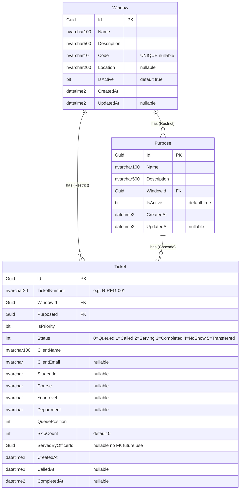

# EduQueue — Entity Relationship Diagram



---

## Relationships

| Relationship | Cardinality | On Delete |
|---|---|---|
| `Window` → `Purpose` | One-to-Many | **Restrict** — cannot delete a Window that has Purposes |
| `Window` → `Ticket` | One-to-Many | **Restrict** — cannot delete a Window that has Tickets |
| `Purpose` → `Ticket` | One-to-Many | **Cascade** — deleting a Purpose deletes its Tickets |

---

## Ticket Status Lifecycle

```
          ┌──────────────────────────────┐
          │          Queued (0)          │◄──── re-queued on NoShow
          └─────────────┬────────────────┘
                        │ CallNext (priority-first, then FIFO)
                        ▼
                    Called (1)
                        │
          ┌─────────────┴────────────┐
          │                          │
          ▼                          ▼
     Serving (2)               NoShow (4)
          │                    (SkipCount++)
          │
   ┌──────┴────────┐
   │               │
   ▼               ▼
Completed (3)  Transferred (5)
               (→ new Window)
```

---

## Database Indexes

| Index Name | Table | Column(s) | Type |
|---|---|---|---|
| `IX_Windows_IsActive` | `Windows` | `IsActive` | Standard |
| `IX_Windows_Code` | `Windows` | `Code` | Unique, filtered (`Code IS NOT NULL`) |
| `IX_Purposes_IsActive` | `Purposes` | `IsActive` | Standard |
| `IX_Purposes_WindowId` | `Purposes` | `WindowId` | Standard |
| `IX_Tickets_TicketNumber` | `Tickets` | `TicketNumber` | Standard |
| `IX_Tickets_WindowId_Status` | `Tickets` | `WindowId`, `Status` | Composite |
| `IX_Tickets_PurposeId` | `Tickets` | `PurposeId` | Standard |

---

## Migration History

| Migration | What Changed |
|---|---|
| `InitialCreate` | Created `Tickets` table |
| `RenameIsPriorityColumn` | Renamed `isPriority` → `IsPriority` |
| `AddWindowEntity` | Created `Windows` table; added FK from `Tickets.WindowId` (Cascade) |
| `AddWindowNavigation` | Changed `Tickets.WindowId` FK delete rule: Cascade → **Restrict** |
| `AddWindowUpdatedAt` | Added `Windows.UpdatedAt` column |
| `AddPurposeEntity` | Created `Purposes` table; added `Tickets.PurposeId` FK (Cascade) |
| `AddWindowCode` | Added `Windows.Code` with unique filtered index |

---

## Notes

- **`Window.Code`** is optional but required for meaningful ticket numbers. Format: `{R|P}-{CODE}-{DailySeq:D3}` (e.g. `R-REG-001`, `P-REG-002`). When `Code` is null, a partial UUID is used instead.
- **`Ticket.ServedByOfficerId`** is a nullable `Guid` placeholder for a future `Officer`/`User` entity — no FK constraint exists yet.
- **`IsActive`** on `Window` and `Purpose` acts as a soft-delete. `Ticket` uses `Status` for its lifecycle instead.
- **Priority queue logic** is enforced at the application layer: `IsPriority = true` tickets are always called before regular ones, with `CreatedAt` as the tiebreaker.
- **`NoShow` tickets are re-queued** — they remain eligible for `CallNext`, and `SkipCount` tracks how many times a client missed their call.
